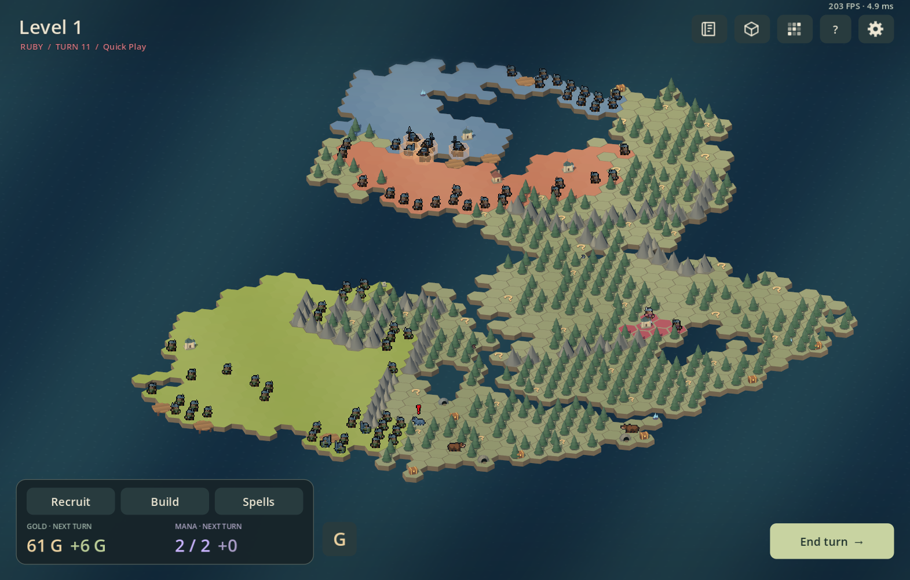
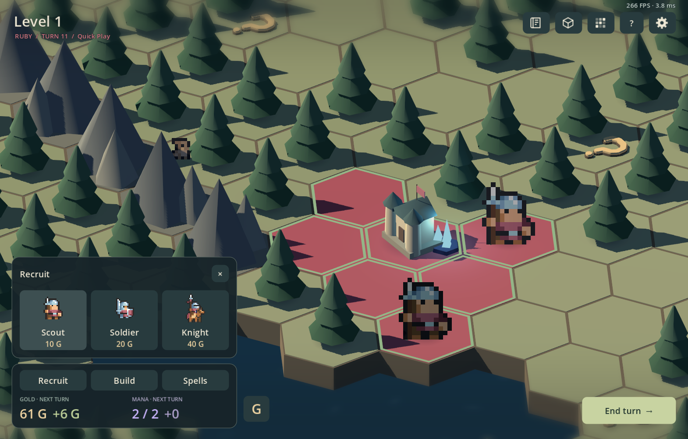
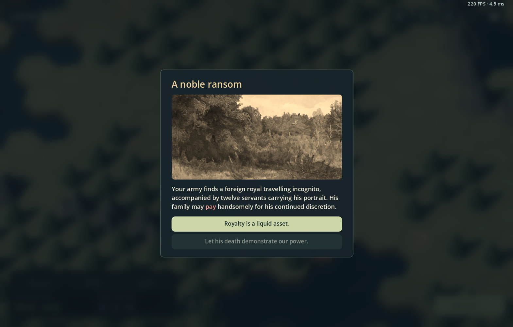
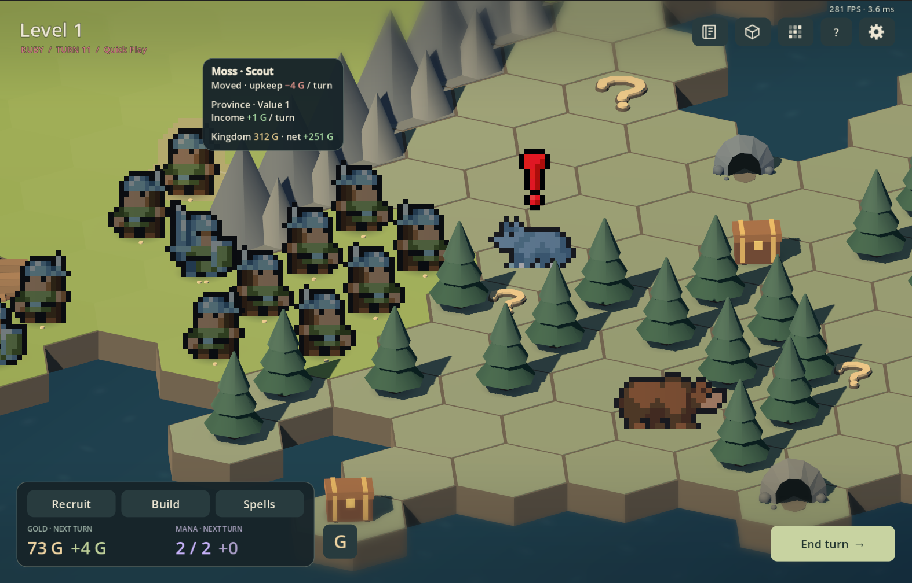
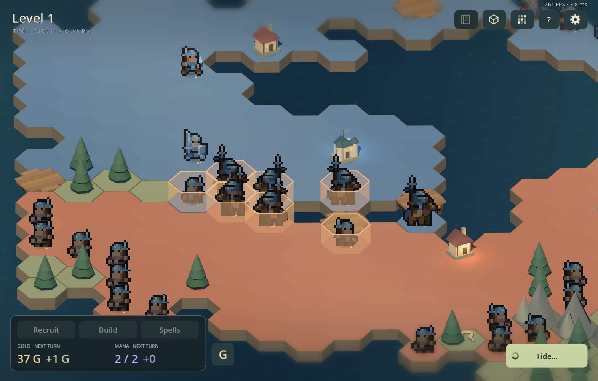

# Slay & Reign

A Slay-inspired, turn-based strategy game made in Godot. Expand across a raised
hex island, manage connected kingdoms, and use armies, buildings and spells to
capture rival capitals. Procedural terrain, low-poly scenery and pixel soldiers
give the board a small diorama feel.

**Current development version: 0.3.0 — Castles and Ore.**
See the [changelog](CHANGELOG.md) for release history and the
[current rules and balance settings](docs/castles-and-ore.md) for the latest changes.



<details>
<summary>More screenshots: recruitment, encounters, wildlife and border battles</summary>

| Recruitment | Exploration encounters |
| --- | --- |
|  |  |
| **Wildlife and treasure** | **Border battles** |
|  |  |

</details>

*Screenshots show an earlier development build; the current rules include Ore and building tiers.*

## Getting started

1. Install **Godot 4.6.3**. The standard editor works; no custom engine is required.
2. Import `project.godot` and press **F5** to launch the game.
3. Choose **Tutorial** to learn the rules, or **Quick Play** to start a match.

You can also launch from the project folder with Godot on your PATH:

```powershell
godot --path .
```

Steam is optional for solo and local play. Online multiplayer uses the bundled
GodotSteam extension for **Windows x86-64**; see the
[Steam setup guide](docs/steam-multiplayer.md) for requirements and other platforms.

## Playing

- **Quick Play:** play against computer opponents on five map sizes, from Tiny
  (about 80 tiles) to Huge (about 1,000). Choose your kingdom and difficulty.
- **Tutorial:** eight guided topics cover armies, economy, defences, supply
  lines, magic and exploration, followed by a practice match.
- **Multiplayer:** share a computer for local turns, or host a friends-only
  Steam lobby. Steam development builds use Spacewar (App ID 480).
- **Level editor:** create an island, paint terrain and starting kingdoms, then
  playtest it or load it into a local multiplayer match.
- **Replays:** save completed matches from the results screen and watch them
  with playback controls and a free camera.

Kingdoms maintain their own gold treasuries; mana and Ore are shared by faction.
Castles extend recruitment, Towers defend territory, and roads and bridges help
connect your land. In 0.3.0, Ore funds building upgrades and Knight recruitment.
Each controlled Ore source produces **1 Ore per 3 development** each turn.
Castles, Towers and Capitals have three tiers; Bridges retain their existing rules.

Houses indicate development on owned provinces: development 1–2 has no houses,
while levels 3–6 show one through four. Inspect a province or use the value
heatmap to read its exact development.

### Default controls

| Action | Control |
| --- | --- |
| Select a province or unit; confirm an action | Left-click |
| Cancel an action or selection | Right-click |
| Rotate and tilt the camera | Right-drag |
| Pan | Middle-drag or WASD |
| Zoom | Mouse wheel |
| Switch overhead / 3D view | Tab |
| Toggle development heatmap | F |
| Open Recruit / Build / Spells | Q / E / R |
| Choose a card in an open action menu | Q / E / R, left to right |
| Develop the inspected province | G |
| End turn | Space |
| Speed up movement playback | Hold Ctrl |
| Cancel / pause | Escape |
| Toggle FPS overlay | F3 |

Keyboard bindings can be changed in **Options > Controls**. The in-game **?**
button shows help. See [keyboard bindings](docs/key-bindings.md) and
[player settings](docs/settings.md) for more detail.

## Guides

| Topic | Documentation |
| --- | --- |
| Castles, Ore, building tiers and balance constants | [0.3.0 rules](docs/castles-and-ore.md) |
| Recruitment, roads and connected kingdoms | [Logistics](docs/cities-and-logistics.md) |
| Guided lessons | [Tutorial](docs/tutorial.md) |
| Local sessions and menu navigation | [Session menus](docs/session-menus.md) |
| Steam lobbies, invitations and testing | [Steam multiplayer](docs/steam-multiplayer.md) |
| Map sizes and kingdom limits | [Nation capacity](docs/nation-capacity.md) |
| Audio, video, interface and accessibility | [Settings](docs/settings.md) |
| Recording and watching matches | [Replays](docs/replays.md) |
| Creating maps | [Level editor](docs/level-editor.md) |
| Creating encounters | [Event Editor](docs/event-editor.md) |
| Authoring guided lessons | [Tutorial Editor](docs/tutorial-editor.md) |
| Language packs and translations | [Localization](docs/localization.md) |
| Collected event artwork | [Painting collection](docs/painting-collection.md) |
| Closed playtest packaging and handoff | [Playtest organizer guide](docs/playtest/organizer.md) |

**Event Editor.cmd** and **Tutorial Editor.cmd** launch the standalone authoring
windows on Windows. The level editor is available from the game's main menu.

## Development

### Project layout

| Path | Contents |
| --- | --- |
| `scenes/` | Application entry and gameplay scenes |
| `src/app/` | Main menu, sessions and pause navigation |
| `src/game/` | Rules, economy, generation, AI, actions and balance catalogs |
| `src/rendering/` | Board, camera, procedural models and unit presentation |
| `src/ui/` | HUD, contextual panels, dialogs and options |
| `src/settings/` | Saved preferences, key bindings and player data |
| `src/network/` | Multiplayer sessions and synchronization |
| `src/editor/`, `src/tutorial_editor/` | Map and tutorial authoring |
| `src/audio/`, `resources/audio/` | Audio playback, cue registry and bus layout |
| `assets/`, `resources/`, `tutorials/` | Art, game data and teaching scenarios |
| `tests/` | Regression suites and deterministic fixtures |
| `tools/` | Test runner, versioning, editors and preview helpers |
| `docs/` | Feature guides, implementation notes and historical reports |
| `artifacts/` | Ignored generated captures, logs and other local output |

For implementation details, start with [world generation](docs/world-generation.md),
[the AI system](docs/ai-system.md), [architecture](docs/architecture-implementation-2026-10-17.md)
and [Steam multiplayer](docs/steam-multiplayer.md). Dated reports in `docs/` record
measurements and decisions at the time they were written.

### Verification

Run the full Godot and Python regression suite on Windows with **Python 3.10+**
and the Godot console executable:

```powershell
./tools/run_tests.ps1 -Godot "C:/path/to/Godot_console.exe"
```

Use `-Python "C:/path/to/python.exe"` to select a Python interpreter. The runner
also treats engine script and runtime errors as failures.

For a focused rules check or a visual preview:

```powershell
godot --headless --path . --script tests/test_castles_ore.gd
godot --path . --script tools/castles_ore_preview.gd
```

Check version metadata and the localization catalogue:

```powershell
python tools/version.py --check
python tools/localization_catalog.py --check
```

To update the game version and matching Windows export metadata, run
`python tools/version.py <version>` and add the release notes to
[CHANGELOG.md](CHANGELOG.md).
